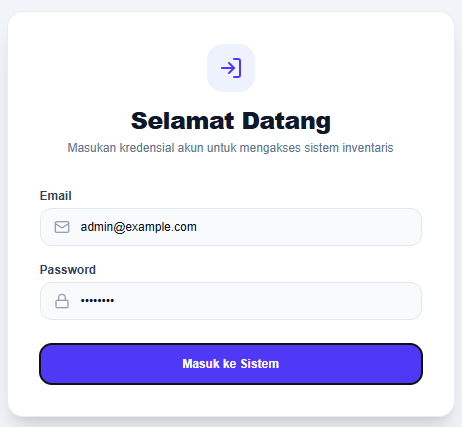

# Inventaris Kantor & ATK

> Aplikasi internal untuk mengelola inventaris aset kantor, persediaan ATK, transaksi dan peminjaman aset. **Dokumentasi setup developer** untuk repository `Central-Saga/Elga-Project1-InventarisKantor`.



## Isi dokumentasi

- [Gambaran sistem](#gambaran-sistem)
- [Teknologi & struktur direktori](#teknologi--struktur-direktori)
- [Persiapan](#persiapan)
- [Menjalankan lokal](#menjalankan-lokal)
- [Pengujian akun demo](#pengujian-akun-demo)
- [Screenshot aplikasi](#screenshot-aplikasi)
- [Troubleshooting](#troubleshooting)
- [Catatan keamanan](#catatan-keamanan)

## Gambaran sistem

Sistem terbagi menjadi dua aplikasi: backend Laravel menyediakan API dan pengaturan akses; frontend Next.js menyajikan antarmuka untuk dua peran utama.

| Role | Area dan tugas utama |
|---|---|
| **Admin** | Dashboard, pengelolaan aset, ATK, pengguna, peminjaman, permintaan ATK, serta histori transaksi |
| **User / Employee** | Dashboard pengguna, melihat aset/ATK, mengajukan peminjaman, mengirim permintaan ATK, dan melihat riwayat pengajuan |

**Alur singkat:** pengguna login → frontend mengirim permintaan ke API Laravel → Laravel memeriksa identitas/role → PostgreSQL menyimpan data dan transaksi → frontend menampilkan hasil sesuai hak akses.

> Daftar fitur ini disusun dari struktur halaman dan controller proyek yang telah diperiksa selama pengembangan. Status operasi spesifik tetap perlu diuji pada versi branch yang hendak digabung.

## Teknologi & struktur direktori

| Lapisan | Teknologi |
|---|---|
| Frontend | Next.js, React, TypeScript |
| Backend | Laravel (PHP), API |
| Database | PostgreSQL |
| Lokal | Docker Compose untuk PostgreSQL, Laravel API, dan Next.js |
| Autentikasi | Login berbasis email/password dengan pembatasan role pada API |

```text
inventaris-kantor-dan-atk/
├── backend/                 # Laravel API, migration, seeder, controller
│   ├── app/Http/Controllers/Api/
│   ├── database/seeders/
├── frontend/                # Next.js dan halaman Admin/User
│   └── src/app/
├── compose.yaml             # Docker Compose di root
└── README.md
```

## Persiapan

- Git.
- Docker Desktop dengan integrasi WSL aktif, atau instalasi Docker yang mendukung `docker compose`.

## Menjalankan lokal

Clone repository, lalu jalankan semua service dari root repository:

```bash
git clone https://github.com/Central-Saga/Elga-Project1-InventarisKantor.git
cd Elga-Project1-InventarisKantor
docker compose config --quiet
docker compose up --build -d
docker compose ps
```

Compose membangun dan menjalankan PostgreSQL, Laravel API, serta Next.js. API menunggu PostgreSQL sehat, membuat `APP_KEY` lokal bila belum ada, lalu menjalankan migrasi dan seeder sebelum melayani request. Buka **http://localhost:3000/login**; API tersedia di **http://localhost:8000**.

Untuk melihat status dan log:

```bash
docker compose ps
docker compose logs -f api frontend
```

Untuk menghentikan container tanpa menghapus data PostgreSQL:

```bash
docker compose down
```

Kredensial default Compose, mode debug, dan akun demo hanya untuk development lokal; jangan deploy konfigurasi ini dengan nilai default. Volume database tetap tersimpan setelah `docker compose down`. Perintah `docker compose down -v` menghapus database lokal secara permanen dan tidak diperlukan untuk menjalankan ulang aplikasi.

## Pengujian akun demo

Untuk pengembangan lokal, informasi seeder yang pernah diperiksa pada proyek ini menunjukkan contoh berikut:

| Role | Email demo | Password demo | Tujuan |
|---|---|---|---|
| Admin | `admin@example.com` | `password` | `/admin/dashboard` |
| Employee / User | `budi@example.com` | `password` | `/user/dashboard` |

Akun demo akan dibuat otomatis saat service API pertama kali dijalankan. Seeder memakai `updateOrCreate`, jadi API yang dimulai ulang dapat memperbarui akun dan data contoh yang memiliki email atau kode sama. Password contoh hanya untuk development lokal dan tidak boleh dipakai pada deployment.

Detail uji login: [docs/LOGIN_PER_ROLE.md](docs/LOGIN_PER_ROLE.md).

## Screenshot aplikasi

### Login


### Admin dan User

Screenshot login sudah disertakan. Screenshot dashboard dan fitur lain berikut direkomendasikan sebagai pelengkap, diambil dari aplikasi yang sedang berjalan (jangan gunakan screenshot aplikasi atau repository lain):

| Screenshot yang disarankan | Halaman |
|---|---|
| Admin dashboard | `/admin/dashboard` |
| Manajemen aset | `/admin/assets` |
| Manajemen ATK | `/admin/atk` |
| Pengajuan dan peminjaman | `/admin/atk-requests`, `/admin/loans` |
| User dashboard | `/user/dashboard` |
| Halaman peminjaman User | `/user/loans` |

Simpan gambar tambahan di `docs/screenshots/` dan tautkan secara relatif dari README. Lihat [panduan screenshot](docs/SCREENSHOT_GUIDE.md).

## Troubleshooting

| Kendala | Penanganan |
|---|---|
| Container `api` gagal dimulai | Periksa `docker compose logs api db`; API menjalankan migrasi dan seeder saat startup, dan akan berhenti bila salah satunya gagal |
| Login menolak password demo | Pastikan container `api` sehat dan seeder berhasil (`docker compose logs api`) |
| Port 3000/8000/5432 sudah dipakai | Periksa `docker compose ps` dan `docker ps`; atur `FRONTEND_FORWARD_PORT`, `API_FORWARD_PORT`, atau `DB_FORWARD_PORT` sebelum menjalankan Compose. Jangan hentikan container lain tanpa memastikan pemiliknya |
| Frontend tidak dapat menjangkau API pada host/port khusus | Set `NEXT_PUBLIC_API_URL` ke URL API yang dapat diakses browser, lalu rebuild frontend dengan `docker compose up --build -d frontend` |

## Catatan keamanan

- Jangan commit `.env`, `.env.local`, token, password, connection string asli, atau private key.
- Jangan gunakan password contoh pada aplikasi publik.
- Terapkan otorisasi per role di backend, bukan hanya menyembunyikan menu frontend.
- Pakai database terpisah untuk test dan development.
- Review perubahan dan test sebelum merge Pull Request.

## Kontribusi dan Issue

Repository: [Central-Saga/Elga-Project1-InventarisKantor](https://github.com/Central-Saga/Elga-Project1-InventarisKantor).

Dokumentasi ini disiapkan untuk **Issue #34 — README lengkap + `.env.example` + cara run**. Pastikan langkah setup dijalankan pada lingkungan lokal baru sebelum menggunakan dokumentasi untuk versi atau konfigurasi yang berbeda.
